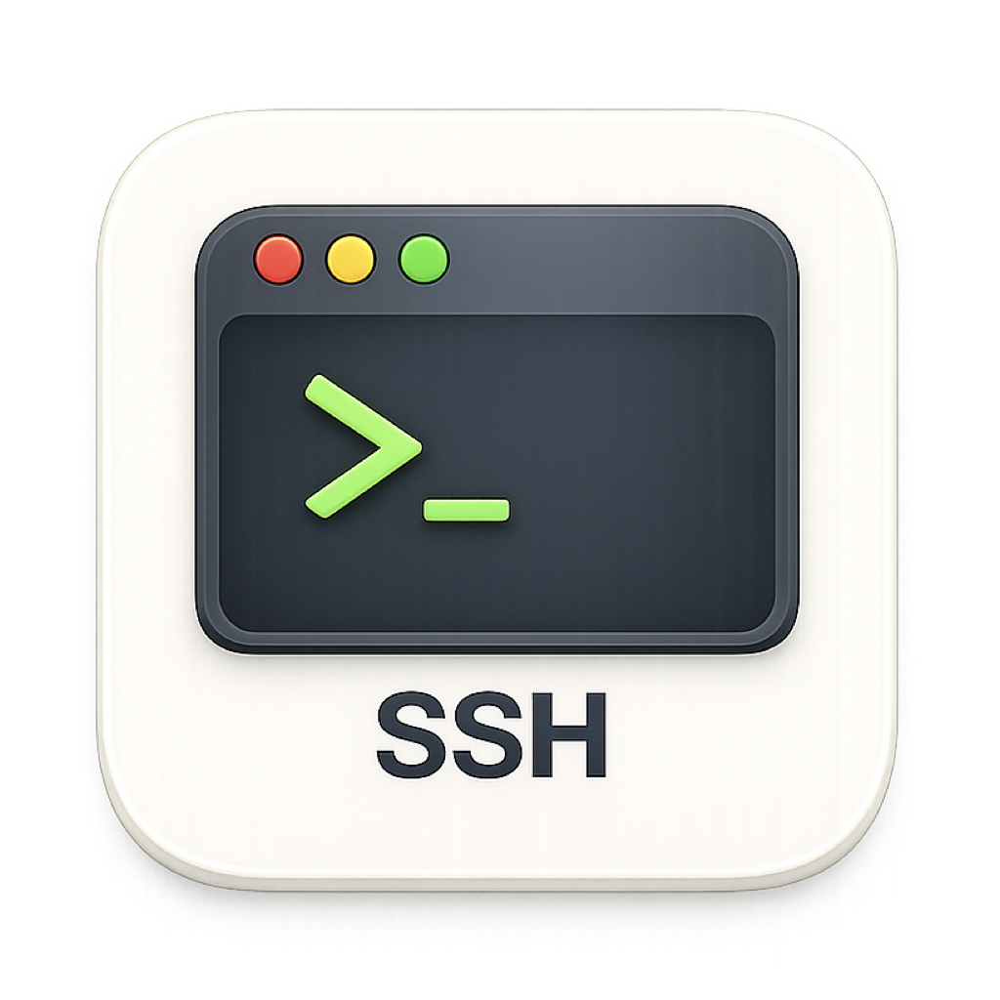
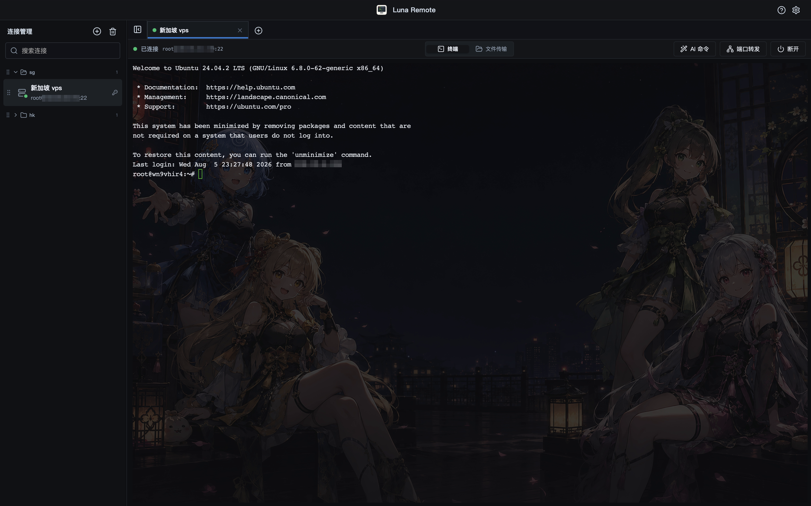
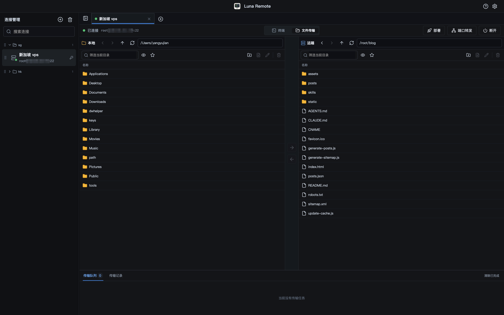
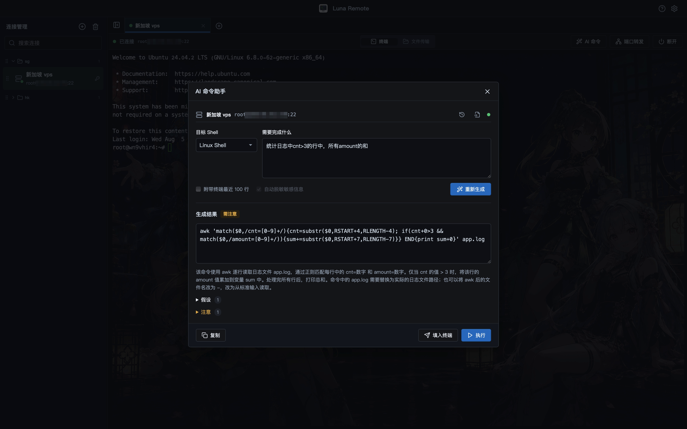

<div align="center">
  
  <h1>Luna Remote</h1>
  <p>An SSH and SFTP desktop client for macOS and Windows</p>
  <p>
    <a href="https://github.com/rainj2013/luna-remote/releases/latest"></a>
    <a href="https://github.com/rainj2013/luna-remote/actions/workflows/release.yml"></a>
    
  </p>
  <p>
    <a href="https://github.com/rainj2013/luna-remote/releases/latest">Download the latest release</a>
    ·
    <a href="docs/DEVELOPMENT.md">Development guide</a>
  </p>
</div>

<div align="center">English · <a href="README.md">简体中文</a></div>

Luna Remote keeps everyday remote work in one window. Connect to a server, move between Terminal and SFTP, manage port forwarding, organize saved hosts, and run multiple independent sessions.



## SSH terminal

- Password, keyboard-interactive, private-key, and SSH Agent authentication
- Host-key verification, session keepalive, and one-level jump hosts
- Multiple independent sessions to the same server
- Connection groups, sorting, collapse state, favorites, and OpenSSH Config import
- Configurable fonts, sizes, color schemes, transparency, and background images
- Dark, light, and system appearance modes
- English and Simplified Chinese interface

## SFTP and directory deployment

The two-pane file browser displays local files on the left and remote files on the right. Upload, download, preview, rename, delete, or drag files between the panes. Transfers run through a queue and failed tasks can be retried.

Directory deployment compares a saved local directory with a remote directory before uploading only new and changed files. It can optionally remove remote-only files after every upload succeeds.



## Port forwarding

Luna Remote supports local, remote, and dynamic SOCKS5 forwarding. Forwarding profiles are saved with each connection and can be started whenever its SSH session is active.

## AI command assistant

Describe a task in natural language and generate a command for Linux Shell, PowerShell, Windows cmd, or macOS Shell. Each result includes an explanation, assumptions, warnings, and a risk assessment.

Commands can be copied, inserted into the current terminal, or executed after confirmation. Optional terminal context is limited and common credentials and personal information are redacted before sending. The feature works with OpenAI-compatible services and remains entirely optional.



## Local data and personalization

- Credentials are stored in macOS Keychain or Windows Credential Manager
- Connections can be exported, backed up, and restored without credentials
- Transfer history records progress and supports retries
- App icon, interface theme, language, and terminal appearance are configurable

## Downloads

Installers are available from [GitHub Releases](https://github.com/rainj2013/luna-remote/releases/latest).

| Platform | Package | Notes |
| --- | --- | --- |
| macOS Apple Silicon | `Luna-Remote_macos-arm64.dmg` | For M-series Macs |
| macOS Intel | `Luna-Remote_macos-x64.dmg` | For Intel Macs |
| Windows x64 | `Luna-Remote_windows-x64-online-setup.exe` | Downloads WebView2 when required |
| Windows x64 | `Luna-Remote_windows-x64-offline-setup.exe` | Includes WebView2 for offline installation |

The current installers are not signed with public developer certificates. On first launch, macOS requires confirmation in Privacy & Security, and Windows may show an unknown-publisher or SmartScreen warning.

## Development

Luna Remote is built with Tauri 2, React, xterm.js, and Rust. The development environment requires Node.js 24, npm, Rust stable 1.85 or newer, and the native build tools for the target platform.

```bash
fnm install 24
fnm use
rustup default stable
npm ci
npm run dev
```

Run the full verification suite before submitting changes:

```bash
npm run check
npm test
npm run web:build
```

See the [development guide](docs/DEVELOPMENT.md) for project structure, platform setup, packaging, and release details. The development guide is currently written in Simplified Chinese.

## License

Luna Remote is released under the [MIT License](LICENSE). Third-party components and fonts retain their respective licenses.
